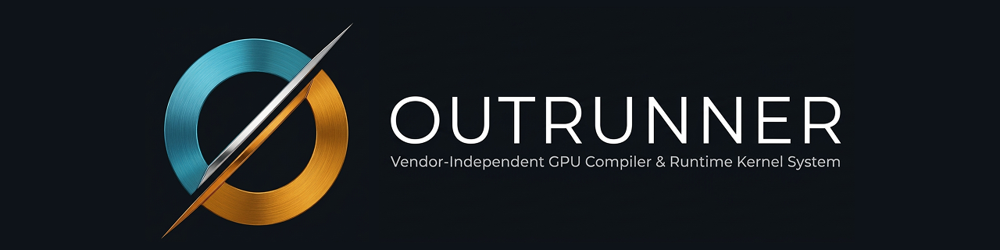

<p align="center">
  
</p>

# Outrunner

> **Status:** Experimental, pre-v0.1 · **Language:** C++20 · **License:** Apache-2.0

Outrunner is an open-source, vendor-neutral GPU compute stack: a small kernel language, a compiler and a runtime that aim to let you write a parallel kernel once and run it fast on CPUs and on GPUs from different vendors. It is inspired by the CUDA programming model, keeps the concepts that make that model approachable, and improves its ergonomics where a clearly better design exists.

Near-native performance is a **goal**, not a claim. No benchmark results exist yet; when they do, they will be published with raw data, scripts and every run, including the losses (`docs/BENCHMARKING.md`).

## Goals

- **Write once, run on many devices:** one kernel for CPUs and for NVIDIA, AMD and Intel GPUs.
- **Familiar concepts:** grids, blocks, threads, shared memory, barriers, streams and events, so GPU programmers feel at home.
- **Better developer experience:** typed memory handles, clearer errors, deterministic floating-point rules across devices, automatic per-device tuning, and diagnostics that explain what the runtime decided and why.
- **Correctness first:** independent reference implementations and an IR interpreter check every backend.
- **Fully open source,** with a clean-room development process (`docs/CLEAN_ROOM.md`).

## Non-goals

- Not a driver replacement.
- Not binary- or source-compatible with CUDA, and not affiliated with or endorsed by NVIDIA. CUDA and other product names are trademarks of their owners and are used descriptively only.
- Multi-vendor portability is a design goal and is **not claimed for any device until tested on it**.

## Planned system

```text
single-source file --> source-splitting driver --> frontend --> IR
                                                                |
                                      runtime: devices, memory, streams, tuning
                                        |                              |
                                  CPU JIT backend               Vulkan backend
                                (x86-64, AArch64)               (SPIR-V compute)
```

The public API is a stable C interface with a header-only C++ wrapper. Details: `docs/ARCHITECTURE.md`.

## Current status

- **Done:** the CPU reference foundation: vector addition and matrix multiplication with correctness tests, a CMake build and CTest integration (`OR-E1`, `OR-M1.1` to `OR-M1.3`). These become the independent reference implementations that every backend is checked against. Final review and documentation of that foundation (`OR-M1.4`).
- **In progress:** Final review and milestone completion (OR-M1.5).
- **Next:** four risk-first spikes (Vulkan matmul ceiling, cooperative-matrix behavior, AsmJit prototype, software Vulkan check), then the v0.1 walking skeleton. See `docs/ROADMAP.md`.
- **Not yet implemented:** the kernel language, compiler, runtime API, CPU JIT backend and Vulkan backend.

## Tested devices

None yet. This table will list every GPU, driver and operating system each release was verified on.

## Build and test

```text
cmake -S . -B build
cmake --build build
ctest --test-dir build
```

Requires a C++20 compiler and CMake. The planned supported platforms are Linux x86-64 and Windows x86-64, with Linux AArch64 verified for correctness only.

## Repository layout

- `include/` public interfaces
- `src/` production implementation
- `tests/` correctness and regression tests
- `benchmarks/` benchmark harness (vendor-native baselines live in a separate repository)
- `experiments/` isolated learning and hardware investigations
- `docs/` specifications, decisions, plans and the learning log

Some directories appear as their components land.

## Documentation

- [Architecture](docs/ARCHITECTURE.md)
- [Design decisions](docs/DESIGN_DECISIONS.md)
- [Roadmap](docs/ROADMAP.md)
- [Technical backlog](docs/TECHNICAL_BACKLOG.md)
- [Testing strategy](docs/TESTING.md)
- [Benchmarking methodology](docs/BENCHMARKING.md)
- [Clean-room policy](docs/CLEAN_ROOM.md)
- [Learning log](docs/LEARNING_LOG.md)
- Kernel language and runtime specifications: [Language specification](docs/LANGUAGE_SPEC.md), [Runtime specification](docs/RUNTIME_SPEC.md)

## Contributing

Outside contributions are not being accepted yet. A contribution policy and contributor agreement will be published before that changes.

## License

Apache-2.0. See `LICENSE`.
